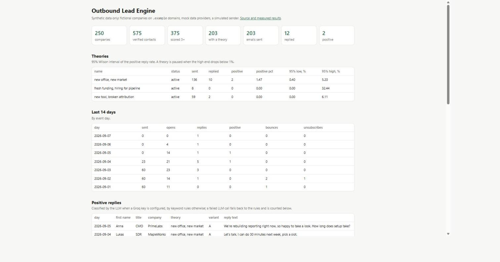
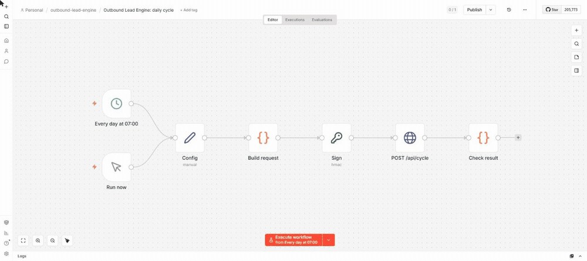
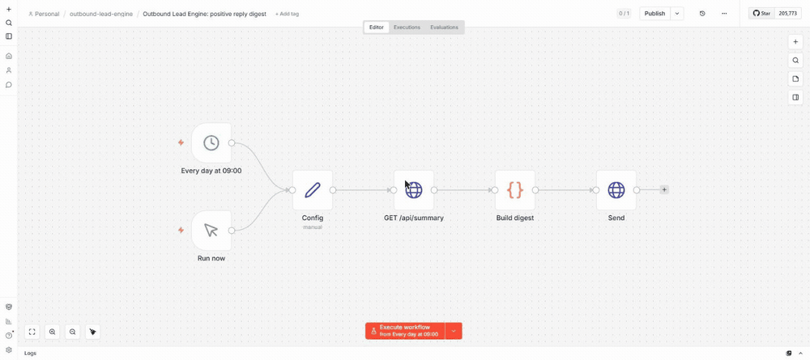

[English](README.md) | **Українська**

# Outbound Lead Engine

Конвеєр вихідної лідогенерації: прийом компаній, каскад збагачення даних, що
спершу кличе найдешевшого постачальника, скоринг лідів, гіпотеза «чому саме ця
людина і чому зараз» для кожного сегмента, листи від AI з валідацією, підписаний
прийом подій і вимикач, що зупиняє гіпотези, на які не відповідають.

**Демо-режим за задумом.** Усі компанії й люди вигадані, кожен домен закінчується
на `.example` (зарезервований RFC 2606, тож жодна адреса не дійде до скриньки),
постачальники даних це моки з форматами відповідей справжніх API, а відправка це
симулятор. Жоден справжній лист не надсилається і дані жодної реальної людини не
обробляються. Модуль LinkedIn Sales Navigator з початкового дизайну лишився тільки
документацією: його автоматизація порушує правила LinkedIn і закінчується баном
акаунтів.

**Живе демо:** [outbound-lead-engine.vercel.app](https://outbound-lead-engine.vercel.app)
(дашборд). Дані йому дає запуск GitHub Actions на вимогу, один симульований день за
запуск: нові листи пише LLM, події симулятора йдуть по HTTPS на підписаний вебхук,
вимикач застосовується. Усі шість етапів зроблені, див. [План](#план).



*Дашборд на локальній копії після 20 симульованих днів (шаблонні листи, класифікація
відповідей за ключовими словами). Живий сайт показує ті самі розрізи над своєю,
молодшою базою.*

## Як це працює в проді

```
GitHub Actions (на вимогу)           n8n (за бажанням, те саме)
  python -m leadengine cycle           POST /api/cycle, підпис HMAC
          │                                     │
          └────────────► один симульований день ◄┘
                 скоринг → сигнали → гіпотеза → лист (Groq)
                 черга в межах лімітів скриньок → симулятор
                 події симулятора ──HTTPS, підпис──► /api/events (Vercel)
                 вимикач за верхньою межею Вілсона
                              │
                     Neon Postgres ◄──── дашборд, /api/summary
```

| частина | де | примітки |
|---|---|---|
| застосунок (дашборд, вебхук, запуск циклу) | Vercel, Python 3.12, FastAPI | `app.py` → `src/leadengine/web.py`; `/health`, `/api/events`, `/api/cycle`, `/api/summary` |
| база | Neon Postgres, `us-east-1`, поруч із типовим регіоном Vercel | міграції запускає задача циклу; застосунок ходить через pooled URL |
| цикл | GitHub Actions `daily cycle`, запуск вручну | `bootstrap` (ідемпотентний), потім `cycle --llm --copy-limit 20` |
| тести | GitHub Actions `tests` на кожен push | контейнер Postgres як сервіс, з обмеженням пам'яті |
| оркестрація | [`n8n/`](n8n) | два воркфлоу, перевірені в n8n 2.16.1 |

Секрети лежать тільки в секретах GitHub Actions і змінних оточення Vercel:
`DATABASE_URL`, `WEBHOOK_SECRET`, `GROQ_API_KEY`.

## Етап 6: воркфлоу n8n



*Обидва воркфлоу імпортовані в справжній n8n 2.16.1 і запущені з редактора проти
локальної копії застосунку з демо-секретом HMAC. Денний цикл: 20 листів написано, 20
поставлено в чергу, 24 підписані події доставлено, на всі відповідь 200. Дайджест нижче,
після 20 симульованих днів: 2 позитивні відповіді відправлені на вхідний вебхук.*



[`n8n/daily-cycle.json`](n8n/daily-cycle.json) підписує `{"copy_limit": 20}` вузлом
Crypto і робить POST на `/api/cycle`; секрет HMAC лежить у зашифрованих облікових
даних n8n, ніколи не в JSON воркфлоу (n8n 2.x до того ж за замовчуванням блокує `$env`
у виразах). [`n8n/positive-digest.json`](n8n/positive-digest.json) читає
`/api/summary` і відправляє позитивні відповіді за останні два дні на вхідний вебхук
Slack або Discord, а коли їх немає, не відправляє нічого.

Перевірено через `n8n import` + `n8n execute` в одноразовому контейнері n8n 2.16.1 з
обмеженням пам'яті проти локальної копії застосунку: два цикли написали по 20 листів і
доставили 23 і 28 підписаних подій, на всі відповідь 200; дайджест відправив 2
позитивні відповіді 20-денної симуляції і промовчав на базі, де їх не було. Деталі й
кроки імпорту: [`n8n/README.md`](n8n/README.md).

Цикл можна запустити з двох місць, тому перед стартом він бере оренду на рядок у базі;
другий виклик отримує 409. Сесійний advisory lock тут не підходить: застосунок ходить
до Neon через pooler у режимі транзакцій, де сесійний лок і його зняття можуть
потрапити на різні серверні з'єднання.

## Етап 5: дашборд і деплой

12 карток Metabase з дизайну стали SQL-представленнями
(`db/migrations/010_dashboard.sql`), які читає застосунок. Три не перенесені: дві про
пул акаунтів LinkedIn (цей модуль лишився документацією) і «вартість воронки», для якої
потрібен середній чек угоди, а його в даних немає.

Перші запуски на живому стеку: день 0 написав 19 листів через Groq і доставив 24 події,
день 1 написав 20 і доставив 28; на кожну подію відповідь 200. Із 20 лідів дня 0 один
лист двічі не пройшов валідацію і повернувся в чергу, як і задумано.

Що зламалось по дорозі, усе виправлено:

- Vercel при імпорті читає `.env.example` і заповнив `DATABASE_URL` локальним значенням
  `localhost:5433`, тож перший деплой відповідав 503, доки значення не замінили.
- Секрети, передані в `gh secret set` з Windows PowerShell 5.1, отримали спереду UTF-8
  BOM (psycopg: `invalid connection option`, з невидимим U+FEFF перед `postgresql://`).
  Перенаправлення файлу через `cmd` передає байти як є.
- Дашборд відповідав 500, коли база недоступна; тепер він показує сторінку 503, а
  `/health` каже `{"db": false}`.

## Етап 4: відправка, події і вимкнення поганих гіпотез

Нічого не надсилається в справжню скриньку: замість постачальника розсилки стоїть
симулятор. Кожна гіпотеза має приховану справжню частку позитивних відповідей, якої
конвеєр не бачить; вимикач має знайти погану тільки за подіями. Події приходять як
підписані вебхуки через той самий обробник, який кликав би справжній постачальник.

### Вимикач з дизайну зупиняє хороші гіпотези

Дизайн зупиняв гіпотезу, коли **нижня** межа Вілсона для частки позитивних відповідей
була нижче 0.5% після 300 відправок. Нижня межа під порогом означає «ми не можемо
виключити, що вона погана», а не «вона погана». Тут гіпотеза зупиняється, коли
**верхня** межа нижче 1%: ми на 95% певні, що вона гірша за 1%.

Монте-Карло, 2000 прогонів на клітинку, 50 відправок на день, перевірка щодня, до 2000
відправок (`python -m leadengine killswitch-mc`):

| справжня частка позитивних | дизайн: зупинено | дизайн: відправок на момент зупинки | тут: зупинено | тут: відправок на момент зупинки |
|---|---|---|---|---|
| 0.25% (погана) | 100% | 300 | 99.6% | 600 |
| 0.5% (погана) | 99.9% | 300 | 78.1% | 900 |
| 1% (2x поріг дизайну) | **82.9%** | 300 | 7.6% | 900 |
| 2% (4x) | **21.9%** | 300 | 0.1% | 400 |
| 3% (6x) | 3.1% | 300 | 0% | |

Правило дизайну вбиває більшість гіпотез, що працюють удвічі краще за його власний
поріг, і кожну п'яту, що працює вчетверо краще. Правило верхньої межі майже ніколи не
зупиняє хорошу гіпотезу і платить за це відправками: гіпотеза з 0.25% доходить до 600
листів замість 300. 7.6% рівно на 1% вищі за номінальні 2.5%, бо правило перевіряється
щодня, а не один раз; це виправив би послідовний тест.

### Те саме в 30-денній симульованій кампанії

1500 компаній, 3 скриньки по 20 листів на день, відповіді класифікує `gpt-oss-20b`,
два прогони на тому самому світі, змінено тільки правило. Симулятор задає поведінку
кожного отримувача від його адреси, тож в обох прогонах та сама людина відповідає
однаково.

| | верхня межа (тут) | нижня межа (дизайн) |
|---|---|---|
| погана гіпотеза (справжня 0.3%) | зупинена на 15-й день, після 594 відправок, 1 позитивна | зупинена на 8-й день, після 321 відправки, 1 позитивна |
| хороша гіпотеза (справжня 1.2%) | лишилась, 359 відправок, 3 позитивні | **зупинена на 11-й день**, після 307 відправок, 2 позитивні |
| найкраща гіпотеза (справжня 3%) | лишилась, 102 відправки, 4 позитивні | лишилась, 102 відправки, 4 позитивні |
| листів надіслано | 1055 | 730 |
| позитивних відповідей | 8 | 7 |
| вебхуків відхилено | 0 з 1615 | 0 з 1123 |
| відповідей класифіковано так, як задумав симулятор | 82 з 82 | 54 з 54 |

Видно обидва ефекти: правило дизайну зупинило погану гіпотезу на 273 листи раніше, але
зупинило й хорошу. Після тієї другої зупинки лишилась тільки гіпотеза з 3%: 511
невідправлених лідів звільнились, майже жоден їй не підійшов, і відправка стала на 12-й
день, тоді як прогін з верхньою межею слав до 17-го. У цьому світі в хорошої гіпотези
лишалось мало лідів, тож хибна зупинка коштувала одну позитивну відповідь; з більшим
пулом вона коштувала б пул. Класифікатор відповідей бачив тексти, яких раніше не
зустрічав (у симулятора власний банк текстів), і правильно розібрав усі 136, за $0.0041
на 82.

Коли гіпотезу зупинено, її ліди, ще не передані відправнику, повертаються на
призначення гіпотези. У прогоні з верхньою межею звільнились 352, і 26 підійшли іншій
гіпотезі; решта пішла в `cold_reserve` із причиною.

### Вебхук

`X-Signature: t=<unix>,v1=<HMAC-SHA256 від "t." + сире тіло>`. Відмінності від
перевірки з дизайну, кожна з тестом:

| у дизайні | тут |
|---|---|
| на поганому підписі кидав `Invalid HMAC signature, got X, expected Y`: хто надіслав підроблений запит, отримував правильний підпис у відповідь | помилка каже тільки, яка перевірка не пройшла |
| підписував `JSON.stringify(розібране тіло)`, тож зміна порядку ключів чи пробілів ламала валідні вебхуки | підписує отримані сирі байти |
| без мітки часу: перехоплений вебхук лишався валідним назавжди | мітка часу всередині підписаних байтів, вікно 5 хвилин, дублікати відкидаються за id події |
| будь-яка відповідь переводила лід у `replied`, включно з автовідповіддю «у відпустці» | автовідповідь лишає лід у `sent`; відповідь після відписки чи bounce її не скасовує |
| зупинка переводила ліди `queued` до іншої гіпотези, хоча відправник уже мав їхній лист | переходять тільки ще не передані ліди |
| «ніколи не зупиняти останню активну гіпотезу» перевірялось після того, як SQL її вже зупинив | перевіряється до; гіпотеза лишається активною |

Відхилені запити записуються з причиною і хешем тіла, ніколи не з самим тілом.

### Генератор гіпотез

Наприкінці симуляції `gpt-oss-120b` прочитав частки відповідей по сегментах і
запропонував три гіпотези («нещодавня заміна техстеку», «пильна увага ради директорів
після раунду», «прискорений найм») за $0.0004. Валідатор приймає тільки сигнали, які
конвеєр уміє отримати (дизайн дозволяв активність у LinkedIn, яку цей проєкт не
автоматизує), значення сегментів, що існують, і нові назви. Пропозиції зберігаються як
`draft`: гіпотеза вирішує, кому піде лист, тож її ввімкнення лишається рішенням людини.

## Етап 3: скоринг, гіпотези, листи, відповіді

LLM: Groq, `openai/gpt-oss-120b` для листів і `openai/gpt-oss-20b` для відповідей,
обидві зі строгим JSON schema на виході. Кожна відповідь однаково перевіряється в коді,
бо схема гарантує форму, а не зміст. Усі числа нижче з реальних прогонів на Groq;
результати по кожному елементу в [`eval/results/`](eval/results).

### Листи: 30 лідів через увесь конвеєр на Groq

`python -m leadengine prepare --copy-limit 30 --dump` на світі seed 42.

| | |
|---|---|
| валідні з першої відповіді | 29 з 30 |
| валідні після одного виправлення | 1 (не використав жодного факту з даних ліда) |
| відхилено остаточно | 0 |
| середня довжина | 48 слів (ліміт 90) |
| вартість | $0.0114 за 30 листів по два варіанти, **$0.38 за 1000** |
| затримка | 1.2 с на запит |

Валідатор переносить правила дизайну (тема до 6 слів і з малої літери, тіло до 90 слів
і до 3 абзаців, закінчується питанням, без плейсхолдерів, без «I hope this finds you
well», без посилань, варіант A відрізняється від B) і додає те, що дизайн лишив на
промпт: **жодних вигаданих фактів**. Кожне число в листі має бути в даних самого ліда, а
«наші клієнти» відхиляються. Власний приклад листа в дизайні казав «Three of our
customers hired their VP DG with us», а таке отримувач може перевірити. Відхилена
відповідь один раз повертається моделі з причинами; після цього лід пробується в
наступному запуску і після 3 спроб іде в `dead_letter`.

На око листи конкретні й фактичні. Дві слабкості, яких валідатор не ловить:
неперевірюване узагальнення без числа («seeing many SaaS teams add HubSpot»)
проходить, і майже кожен варіант A починається з «I saw ...».

### Скоринг: LLM проти рубрики, яку їй дали

Дизайн оцінював кожного ліда через LLM. Рубрика використовує тільки вже структуровані
поля (рівень посади, галузь, розмір, країна), тож тут вона рахується в коді, а
LLM-оцінювач заміряний проти неї на 60 лідах із рубрикою, вписаною в промпт:

| модель | та сама оцінка | різниця до 1 | те саме рішення слати / не слати | вартість на 1000 лідів |
|---|---|---|---|---|
| `gpt-oss-20b` | 56.7% | 98.3% | 83.3% | $0.07 |
| `gpt-oss-120b` | 68.3% | 100% | 83.3% | $0.14 |

Майже кожна розбіжність це модель, що ставить на бал менше: вона бере кількість збігів
критеріїв за оцінку (2 збіги, оцінка 2), хоча промпт каже, що 2 збіги це 3. Менша модель
ще й неправильно читала факти («201-500» як поза ICP, «1000+» як негативний сигнал). З
будь-якою моделлю **1 лід із 6 перейшов би між «пишемо» і «не пишемо»**. Тому скоринг
у коді (`--scoring rules`, за замовчуванням), LLM-оцінювач лишається опцією, а невдалий
виклик LLM відкочується на рубрику і рахується.

### Класифікація відповідей: 40 розмічених відповідей

[`eval/replies.jsonl`](eval/replies.jsonl): шість класів, включно з тонкими випадками з
дизайну («зараз зайнятий» це нейтральна, «не цікаво і більше не пишіть» це відписка,
автовідповідь «у відпустці» з іменем колеги це не рекомендація контакту).

| | точність | вартість на 1000 відповідей |
|---|---|---|
| правила за ключовими словами (база) | 70% (28 з 40) | 0 |
| `gpt-oss-20b` | 100% (40 з 40) | $0.05 |
| `gpt-oss-120b` | 100% (40 з 40) | $0.11 |

База падає на перефразуванні: пропускає 4 з 8 позитивних і 4 з 7 негативних відповідей,
два класи, що важать найбільше. Два застереження щодо 100%. Набір писала та сама
людина, що й промпт, тож він, імовірно, легший за справжні відповіді. І 40 з 40 все ще
лишає справжню частку помилок десь до 7%. Адреса рекомендованого контакту має буквально
бути у відповіді (перевіряється в коді); модель повернула правильну адресу в усіх 4
відповідях, де вона була, і null у 2, де названа людина без адреси.

Класифікатор з дизайну ще повертав самооцінку впевненості. Її прибрано: на попередньому
проєкті модель ставила 1.00 на 36 з 40 відповідей, включно з помилковими.

### Куди йдуть гроші (seed 42, target 3)

| крок | лідів на вході | лідів на виході | вартість |
|---|---|---|---|
| збагачення | 250 компаній | 721 контакт, 578 перевірених | $36.98 |
| скоринг (правила) | 578 перевірених | 375 придатних, 203 нижче 3 | $0 |
| сигнали (раунди, найм, інструменти, новини) | 166 компаній | | $49.80 |
| призначення гіпотези | 375 | 203 з гіпотезою, 172 без підхожої | $0 |
| лист | 203 | | $0.08 за заміряною ціною |

$0.43 на ліда, що доходить до листа, і сам лист це 0.1% від цього. **Сигнали коштують
більше, ніж пошук людей**, і купуються для кожної компанії з придатним лідом, хоча 172
з 375 лідів потім не підходять жодній гіпотезі. Очевидна наступна економія: брати тільки
сигнал, потрібний найдешевшій підхожій гіпотезі, по одному.

### Помилки дизайну, виправлені на цьому етапі

| у дизайні | тут |
|---|---|
| скоринг пропускав оцінку 3, а збагачення змінних брало тільки 4, тож кожен лід з оцінкою 3 отримував гіпотезу і чекав вічно | один поріг; тест доводить ліда з оцінкою 3 до `variables_ready` |
| гіпотеза призначалась до отримання її змінних; компанія без раунду інвестицій лишала ліда застряглим | гіпотеза призначається, тільки якщо в компанії є всі потрібні змінні, інакше `cold_reserve` із причиною |
| генерація листа ставила статус `generating_copy`, якого в схемі немає | `drafting` |
| класифікатор відповідей повертає `referral`, а `events.reply_class` його відхиляв | дозволено; є тест |
| призначення гіпотези оновлювало ліди без блокування | `SKIP LOCKED`, як на кожному іншому кроці |
| сигнали отримувались на кожного ліда і гіпотезу | один раз на компанію; тест перевіряє, що 3 ліди коштують 1 запит |

Запуски, що падають посеред кроку, лишають ліди в `scoring` чи `drafting`; наступний
запуск звільняє захоплення, старші за 15 хвилин, і рахує це як спробу.

## Етап 2: каскад збагачення

Чотири постачальники даних, від найдешевшого: Apollo, Hunter, Snov, PhantomBuster.
Кожен знайдений контакт перевіряється в Findymail, перш ніж зарахуватись. Дорожчий
постачальник викликається, тільки доки дешевші не дали `--target` перевірених
контактів для компанії.

### Заміряно на світі seed 42 (250 компаній, 882 людини)

`python -m leadengine enrich --target N`, ціни з таблиці витрат початкового дизайну
(`src/leadengine/providers/clients.py`, одне місце). Прогони відтворювані: два прогони
дають ідентичні числа.

| правило зупинки | компаній з перевіреним контактом | перевірених лідів | вартість | на 1000 перевірених лідів |
|---|---|---|---|---|
| `--target 1` (дизайн: стоп на першому знайденому) | 235 з 250 | 426 | $17.30 | $40.62 |
| `--target 3` (за замовчуванням) | 235 з 250 | 578 | $36.98 | $63.98 |
| `--target 99` (кликати всіх) | 235 з 250 | 656 | $64.29 | $98.00 |

Що каже таблиця:

- **Правило дизайну вже досягає кожної досяжної компанії.** Усі три правила знаходять
  перевірений контакт у тих самих 235 компаніях (у решти 15 немає нікого, хто проходить
  перевірку). Додаткові гроші купують глибину, а не охоплення: 1.8 перевіреної людини на
  компанію при target 1, 2.5 при target 3.
- **Кожен наступний лід швидко дорожчає.** Перехід з target 1 на 3 додає 152 перевірені
  ліди за $19.68, по $0.13. Перехід з 3 на «все» додає 78 за $27.31, по $0.35.
- **PhantomBuster це 46% рахунку за 12% контактів** при target 3: $17.00 з $36.98, 85 з
  721 збереженого контакту. Він бере гроші за кожного поверненого ліда і повертає всіх,
  кого знає в компанії, включно з людьми, яких уже знайшли дешевші: він повернув 340
  людей, і 255 з них були дублями, за які заплатили й викинули. Apollo для порівняння
  коштував $7.33 за 458 контактів.
- **Перевірка це друга за розміром стаття**, $8.65 за 721 адресу. Саме вона не пускає у
  відправку 93 ризикові (catch-all) і 50 невалідних адрес: вони зберігаються, але
  `leads_sendable` повертає тільки перевірені.

### Той самий прогін із впорскуванням збоїв

`--rate-429 0.10 --rate-5xx 0.03 --phantom-empty 0.10`: один виклик із десяти впирається
в rate limit, три зі ста падають з 503, а один запуск PhantomBuster із десяти
завершується «успішно» без даних, що й буває, коли спливає його сесійна кука LinkedIn.

| | чисто | зі збоями |
|---|---|---|
| компаній провалено | 0 | 0 (одна повторена і пройшла в наступному циклі) |
| викликів | 2519 | 2895 |
| перевірених лідів | 578 | 573 |
| компаній з перевіреним контактом | 235 | 234 |

429 і 503 коштують тільки викликів: повтори поглинули всі, дані не загубились. 5
відсутніх лідів і 1 загублена компанія походять з 14 тихих порожніх запусків
PhantomBuster. Помилки на них не було; єдиний слід це лічильник `phantom empty runs`.
Саме на нього варто ставити алерт.

### Як це зроблено

- **Мок-постачальники** (`providers/mock.py`) відповідають із синтетичного світу з
  незручностями справжніх API: пошук Apollo маскує адреси, і кожне розкриття це окремий
  платний `people/match`; Hunter гортає сторінки зсувом і повертає рольові скриньки без
  імені; Snov вимагає OAuth-токен, що спливає за годину, і гортає по `lastId`;
  PhantomBuster це запуск, опитування, вибірка. Збої визначаються самим запитом, а не
  спільною послідовністю, тож результат не залежить від порядку обробки компаній.
- **Повтори** (`providers/http.py`) тільки для транспорту: 429 слухає `Retry-After`
  (до 30 с), 5xx і мережеві помилки з експоненційною паузою, не більше 4 спроб. Будь-яка
  інша 4xx кидається одразу. Невдалі спроби логуються, але не оплачуються.
- **Кожен цикл має межу, що не довіряє API**: не більше 10 сторінок на постачальника,
  курсор Snov, що не зрушив, зупиняє цикл, PhantomBuster опитується не більше 20 разів,
  і одна компанія не може зробити понад 2000 викликів.
- **Журнал витрат** (`provider_calls`): один рядок на HTTP-виклик, включно з невдалими.
  Витрати на людину (розкриття, плата за ліда, перевірка) пишуться ще й на ліда; пошуки
  по домену належать компанії і є тільки в журналі.
- **Захоплення і збої**: запуск захоплює пачку через `SKIP LOCKED` і комітить захоплення
  до будь-якого HTTP-виклику. Усе знайдене для компанії пишеться однією транзакцією з її
  статусом і журналом. Недоступний постачальник повертає компанію в чергу, три збої
  переводять її в `dead_letter` один раз. Запуск, що впав, лишає свої компанії
  захопленими; наступний звільняє захоплення, старші за 15 хвилин, і рахує це як спробу,
  тож компанія, що щоразу валить процес, не може крутитись вічно.

### Протестовано (37 тестів, мок через `httpx.MockTransport`, справжній Postgres)

Серед них: два запуски в паралельних потоках на 40 компаніях жодного разу не кличуть
постачальника двічі для однієї компанії, і обидва справді працювали; каскад, де 30%
викликів упираються в rate limit, зберігає рівно тих самих лідів, що й чистий; дорогий
постачальник ніколи не кличеться для компанії, яку покрили дешеві; людина, знайдена
двома постачальниками, зберігається й оплачується один раз.

## Етап 1: схема і синтетичні дані

### Схема з виправленими помилками початкового дизайну

Дизайн, який реалізує цей проєкт, мав SQL, що в проді впав би або поводився б
неправильно. Кожне виправлення нижче закріплене тестом на справжньому Postgres:

| Проблема в дизайні | Виправлення | Тест |
|---|---|---|
| Два запуски, що перекриваються, захоплювали ту саму пачку і платили за збагачення двічі | `claim_companies` / `claim_leads` з `FOR UPDATE SKIP LOCKED` і зміною статусу в одному запиті | дві відкриті транзакції захоплюють 20 + 10 з 30 рядків, без перетину |
| Агрегатор «змінні готові» використовував `COUNT(DISTINCT (subquery))` у `HAVING`, що Postgres відхиляє | JSONB containment: `required_variables <@ collected_keys` | повний, частковий і порожній набір змінних |
| `mark_lead_failed` після ліміту на кожному виклику вставляв ще один рядок dead letter | переводить ліда в `dead_letter` рівно один раз і назад у явний статус повтору, ніколи наосліп у `new` | 6 збоїв: `[F, F, T, F, F, F]`, 1 рядок |
| Ту саму людину могли зберегти стільки разів, скільки постачальників її знайшли | унікальний `(company_id, email)` | дубль при вставці кидає помилку |
| Статуси були вільним текстом, опечатка створювала статус, який ніхто не читає | `CHECK` на кожному статусі | `'scroed'` відхиляється |
| Пошук у списку відписаних переводив обидві сторони в нижній регістр і не міг використати ключ | адреси зберігаються в нижньому регістрі обмеженням, звичайна рівність | відписаний лід не може отримати лист |
| `\connect` тільки для psql і неідемпотентний `ALTER TABLE` ламали будь-який інший раннер і повторний запуск | звичайний SQL, можна запускати повторно | другий `migrate` нічого не застосовує |

Видалення за GDPR прибирає ліди людини, події, змінні й повідомлення і додає адресу в
список відписаних, навіть коли нічого не знайдено, тож пізніший імпорт теж блокується.

### Раннер міграцій

Тільки вперед, одна транзакція на файл, з контрольними сумами. Застосований файл, який
потім відредагували, відхиляється. Написання його тесту зловило справжню помилку: у
psycopg 3 блок `transaction()` усередині неявно відкритої транзакції це лише savepoint,
тож міграція, що падала, тихо відкочувала попередні. Тепер раннер вимагає вільного
з'єднання, а тест доводить, що збій у файлі 2 зберігає файл 1.

### Синтетичний світ

`python -m leadengine generate --seed 42 --companies 250`, детермінований для кожного
seed. Заміряно на seed 42:

| | |
|---|---|
| компаній / людей | 250 / 882 |
| вхідних рядків (URL, `www.`, верхній регістр, адреси, сміття) | 398 |
| після нормалізації | 250 вставлено, 144 дублі злито, 4 відхилено як не домен |
| друге завантаження | 0 вставлено |
| людей, яких має хоча б один дешевий постачальник (Apollo, Hunter, Snov) | 753 (85.4%) |
| людей, яких має тільки дорогий постачальник | 121 (13.7%) |
| людей, яких немає ні в кого | 8 (0.9%) |
| статус адреси valid / risky / invalid | 698 / 120 / 64 |
| рольові скриньки (`info@`, `sales@`) / без прізвища | 44 (5.0%) / 80 (9.1%) |

Саме останні рядки мають обробити каскад і перевірка з етапу 2.

## Запуск

Потрібно: Docker Desktop.

```powershell
docker compose -p outbound-lead-engine up -d        # локальний Postgres з обмеженням пам'яті на :5433
copy .env.example .env
python -m leadengine migrate
python -m leadengine generate
python -m leadengine seed
python -m leadengine enrich --target 3            # додати --rate-429 0.1 тощо для збоїв
python -m leadengine prepare --copy-limit 30 --dump   # потрібен GROQ_API_KEY
python -m leadengine eval-replies                  # 40 розмічених відповідей проти LLM
python -m leadengine eval-scoring --n 60           # оцінка LLM проти рубрики
python -m leadengine killswitch-mc                 # правила зупинки, Монте-Карло
python -m leadengine simulate --days 30 --classifier llm --propose
```

Живі запуски на цій машині йдуть через `.\scripts\run_live_capped.ps1 -WithDb -Command '...'`:
те саме обмеження пам'яті, що й для тестів, одноразовий Postgres, а ключ Groq
передається через оточення, тож ніколи не з'являється в командному рядку.

`enrich` проганяє всю чергу проти мок-постачальників у тому самому процесі. Паузи повторів
і опитувань не чекаються, а сумуються і показуються як симульований час.

Тести запускаються тільки через раннер з обмеженням: тестовий контейнер і одноразовий
Postgres обидва отримують ліміт пам'яті, що його тримає ядро, сидять в окремій
Docker-мережі і видаляються після прогону.

```powershell
.\scripts\run_tests_capped.ps1
```

Поточний результат: `157 passed`.

Якщо антивірус на вашій машині перехоплює HTTPS (pip в образі падає з
`CERTIFICATE_VERIFY_FAILED`), один раз запустіть `.\scripts\export_local_ca.ps1`. Він
експортує той кореневий сертифікат у git-ignored `.certs/`, а збірка передає його в
`pip install` як секрет BuildKit. Перевірка лишається ввімкненою, і сертифікат не
зберігається в образі.

## План

1. **Схема, міграції, синтетичні дані** (зроблено)
2. **Мок-постачальники з реальними форматами відповідей, 429 і пагінацією; каскад збагачення** (зроблено)
3. **Скоринг, гіпотези й тексти через LLM з валідованим за схемою виходом, запасними шляхами й evals** (зроблено)
4. **Симулятор відправки, підписаний HMAC вебхук подій з ідемпотентністю, вимикач на межі Вілсона, генератор гіпотез** (зроблено)
5. **Дашборд і деплой: Vercel, Neon, цикли в GitHub Actions** (зроблено; дашборд на FastAPI, а не Next.js, бо Vercel тепер запускає Python-застосунок однією функцією, а додати Next.js означає другу збірку)
6. **Воркфлоу n8n, що оркеструють ті самі кроки** (зроблено)
